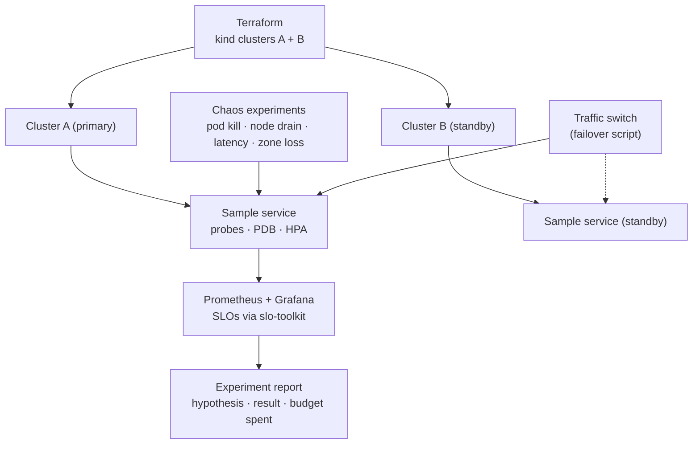

# openshift-k8s-reliability-lab

> **Status: in progress.** Plan only; first working version targeted for January 2027. Nothing below is claimed to work yet.

**A reproducible Kubernetes lab that breaks things on purpose: Terraform builds the clusters, a sample service runs with real SLOs, and scripted chaos experiments show self-healing, failover between two clusters and a staged recovery runbook, with notes for running the same manifests on OpenShift.**

**What this will show**

- **The problem:** resilience features (probes, disruption budgets, autoscaling, failover) are usually configured once and never tested until an incident tests them for you.
- **The SRE skill:** Kubernetes/OpenShift platform reliability, infrastructure as code with Terraform, chaos engineering with hypotheses and measured outcomes, multi-cluster failover and recovery runbooks, all observed through SLOs (Prometheus/Grafana).
- **The business impact:** every resilience claim comes with an experiment that proves it, so a platform team can show what a failure costs in error budget before customers find out.

> Demo screenshot / GIF: added with v0.1.

## Planned experiments (v0.1)

| # | Experiment | Hypothesis |
|---|---|---|
| 1 | Kill pods during load | Readiness probes + replicas keep the SLO; budget barely moves |
| 2 | Drain a node | PodDisruptionBudget keeps capacity; no 5xx spike |
| 3 | Inject latency into a dependency | Timeouts and retries contain it; latency SLO alerts if not |
| 4 | Lose the primary cluster | Failover to cluster B within the runbook's target [CONFIRM target]; budget spend measured |
| 5 | Bad config rollout | Rollout pauses on failing probes; rollback restores the SLO |
| 6 | Staged recovery | Runbook brings back a backlog in batches without overloading downstream |

## Planned components

- [ ] Terraform for two kind clusters, plus Helm installs of kube-prometheus-stack.
- [ ] Sample service with probes, resource limits, PDB and HPA; SLO rules generated by slo-toolkit.
- [ ] Chaos scripts (kubectl-based to start; Chaos Mesh optional) with a hypothesis/result template.
- [ ] Failover script and a written runbook, timed in the experiment report.
- [ ] OpenShift notes: what changes under restricted SCCs, Routes vs Ingress, and user-workload monitoring; tested on OpenShift Local where possible.
- [ ] `make lab-up`, `make experiment N=1`, `make lab-down`; CI that lints Terraform and manifests.

## Why I'm building this

As a Senior Site Reliability Engineer, I led the architecture and production rollout of a migration onto OpenShift (deployment topology, storage, resource limits, release strategy, capacity tuning), and I've worked on failure-mode analysis, chaos testing, failover and recovery automation in a regulated lending environment. This lab rebuilds those ideas in the open, from scratch, on a laptop: no employer or client code, configuration, data or names.

## License

[MIT](LICENSE) © 2026 Mahidhar Chowdhary Salla
